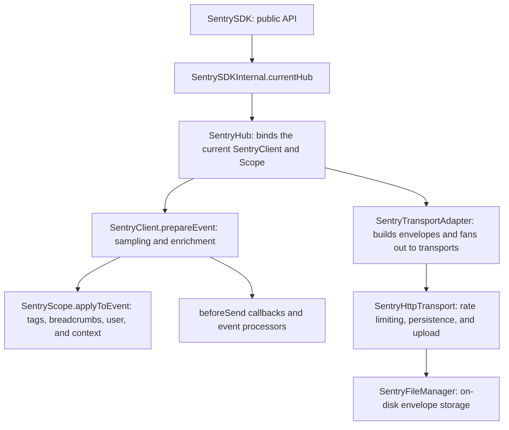
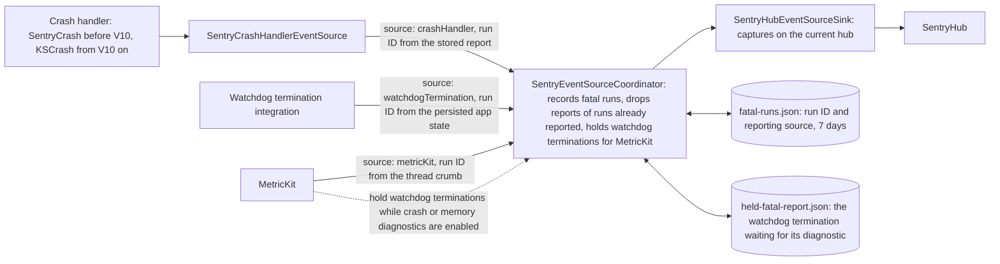

# Sentry Cocoa SDK Architecture

This document provides a high-level overview of the Sentry Cocoa SDK core components and codebase organization.

## Core Architecture

At the highest level, the SDK is composed of a few key components:

- **SentrySDK**: a static wrapper around common functionality
- **SentryOptions**: a configuration class
- **SentryScope**: holds metadata that is sent with every event, to assist in querying later
- **SentryHub** and **SentryClient**: tie together configuration, features and scopes along with lower level machinery needed to store and transmit data

### Event Flow

## Feature Areas

- **Performance Tracking**: `SentryTracer`, `SentrySpan`, `SentryPerformanceTracker` for transaction monitoring
- **App Start Tracking**: `SentryTimeToDisplayTracker` measures TTID/TTFD for UI performance; `SentryLaunchProfiling` manages profiling specifically for app launches
- **Session Replay**: Recording and transmission of user sessions
- **User Feedback**: Both code-based API to send feedback from users, and managed UI to gather it from users
- **Crash Reporting**: Originally forked from KSCrash and independently evolved since then

### Integrations

The SDK packages most feature areas in "integrations" that implement the `SwiftIntegration` protocol. By default, it installs the following (order matters for initialization):

**Core Integrations** (all platforms):

- **SentrySessionReplayIntegration**: Session recording and replay (iOS 16+)
- **SentryCrashIntegration**: Crash detection and reporting
- **SentryANRTrackingIntegration**: Application Not Responding detection
- **SentryAutoBreadcrumbTrackingIntegration**: Automatic breadcrumb collection
- **SentryAutoSessionTrackingIntegration**: Session tracking and release health
- **SentryCoreDataTrackingIntegration**: Core Data performance monitoring
- **SentryFileIOTrackingIntegration**: File I/O performance tracking
- **SentryNetworkTrackingIntegration**: Network request monitoring
- **SentrySwiftAsyncIntegration**: Swift async/await support

**UIKit Integrations** (iOS/tvOS/macOS with UIKit):

- **SentryAppStartTrackingIntegration**: App launch performance measurement
- **SentryFramesTrackingIntegration**: Frame rate and rendering performance
- **SentryPerformanceTrackingIntegration**: Automatic performance transaction creation
- **SentryUIEventTrackingIntegration**: User interaction tracking
- **SentryViewHierarchyIntegration**: View hierarchy capture for debugging
- **SentryWatchdogTerminationTrackingIntegration**: Out-of-memory crash detection
- **SentryScreenshotIntegration**: Screenshot capture on errors

**Platform-Specific Integrations**:

- **SentryUserFeedbackIntegration**: User feedback UI (iOS 13+)
- **SentryMetricKitIntegration**: Apple MetricKit integration (iOS 15+, macOS 12+)

### Event Sources

The crash handler, the watchdog termination integration and MetricKit each learn how a run of the app went or ended. They are event sources: instead of capturing events on the hub themselves, they hand a `SentryEventSourceReport` to a `SentryEventSourceSink`.

- The sources are equal: each one converts its own format into an event, builds its own report and submits it through the same `SentryEventSourceSink` protocol. The crash handler converts in Objective-C, so `SentryCrashHandlerEventSource` builds the report for it. No sink has source-specific entry points.
- A report identifies its pipeline (`source`) and, when the source can read it back, the run it belongs to (`runId`, the ID `SentryCurrentRun` creates for every run). The sink uses the pipeline to process the report the way that pipeline needs, and the run ID to find the reports of other pipelines that describe the same run. The crash handler reads the run ID from the user section of its stored report, the watchdog termination integration from the persisted app state, and MetricKit from the thread crumb the SDK parks at launch (`Sources/Swift/Core/MetricKit/RunId`). A diagnostic report also says how the run ended (`runEnd`), when it does.
- `SentryEventSourceCoordinator` is the one place between the sources and the core SDK. It records every fatal report it lets through in a `SentryFatalRunRecordStore` for seven days, and drops a MetricKit crash diagnostic of a run the crash handler already reported, so one crash yields one event.
- The sources report at different times, and only the watchdog termination gets better by waiting: the crash handler already has the stack trace, and MetricKit, which has the termination reason, always reports last. So the MetricKit integration asks the coordinator through `SentryEventSourceHoldPolicy` to hold watchdog terminations for 30 seconds while crash or memory exception diagnostics are enabled and run IDs can be matched. A held report is stored in `SentryHeldFatalReportStore`, not kept in memory. The store takes the crashed session of the held run out of the place the SDK keeps it for the first fatal event and keeps it with the report, which is sent with that session later. Otherwise a crash while the report is held would replace the session at the next launch, and the held report would be sent without it or with the session of the crashed run. A MetricKit crash or memory exception diagnostic of the held run enriches it (`SentryHeldFatalReportEnrichment`: the watchdog's event keeps its data and gets the threads, debug images and termination reason; a crash with another reason turns it into a MetricKit crash with the previous run's data) and sends it. When the deadline passes, the app moves to the background or the next launch registers the hold first, the report is sent as it is. A diagnostic that arrives after that is sent as its own event, so the reason is never lost. The MetricKit integration installs before the watchdog termination integration so the hold is registered before a watchdog termination is reported.
- `SentryHubEventSourceSink` is the only place where a report reaches the hub. The hub and the client don't know which source an event came from.

The types are in [`Sources/Swift/Core/EventSources`](../Sources/Swift/Core/EventSources).

### Spotlight

In addition to the component that uploads data to the Sentry backend (`SentryHTTPTransport`), customers can also set `SentryOptions.enableSpotlight` to also send that data to a local running program to inspect the contents of the payloads. See more at https://spotlightjs.com and https://github.com/getsentry/spotlight.

### Profiling

In addition to tracing and spans, the SDK provides a sampling profiler that captures the stack traces of all running threads at regular intervals so that developers can see what is happening in their code at a specific time, and aggregate and query the stack trace samples to find performance issues. The SDK supports multiple profiling modes:

### Transaction profiling

The profiler runs on a dedicated thread, and on a predefined interval will enumerate all other threads and gather the backtrace on each non-idle thread.

The information is stored in deduplicated frame and stack indexed lookups for memory and transmission efficiency. These are maintained in `SentryProfilerState`.

If enabled and sampled in (controlled by `SentryOptions.profilesSampleRate` or `SentryOptions.profilesSampler`), the profiler will start along with a trace, and the profile information is sliced to the start and end of each transaction and sent with them an envelope attachments.

The profiler will automatically time out if it is not stopped within 30 seconds, and also stops automatically if the app is sent to the background.

With transaction profiling, there's only ever one profiler instance running at a time, but instances that have timed out will be kept in memory until all traces that ran concurrently with it have finished and serialized to envelopes. The associations between profiler instances and traces are maintained in `SentryProfiledTracerConcurrency`.

### Continuous profiling (beta)

With continuous profiling, there's also only ever one profiler instance running at a time. They are either started manually by customers or automatically based on active root span counts. They aren't tied to transactions otherwise so are immediately captured in envelopes when stopped.

### UI Profiling

Also referred to in implementation as continuous profiling V2. Essentially a combination of transaction-based profiling (although now focused on "root spans" instead of transactions) for the trace lifecycle and continuous profiling beta for the manual lifecycle, with the exception that manual mode also respects a configured sample rate.

The test apps are configured by default to use UI Profiling with trace lifecycle (to override the default of manual lifecycle), traces and profile session sample rates of 1 (to override the defaults of 0), and to use app start profiling.

### Launch Profiling

Key files:

- `Sources/Swift/Profiling/SentryLaunchProfiling.swift`: Main launch profiling logic
- `Sources/Sentry/SentryTimeToDisplayTracker.m`: TTID/TTFD tracking with profiling integration
- `Sources/Sentry/Profiling/SentryProfiledTracerConcurrency.mm`: Profiler/tracer lifecycle management

Order of operations:

- `sentry_startLaunchProfile()` called early in app lifecycle from `SentryTracer.load`
  - for transaction profiling and trace lifecycle UI profiling, a tracer is created to manage profiling session
- Configuration written to disk via `sentry_configureLaunchProfiling` during SentrySDK.start
- Before SentrySDK.start completes, it checks to see if it should stop any running launch profiler
  - if TTID/TTFD tracking is enabled and the launch profile is a transaction profile or UI profile with trace lifecycle, stopping profiles is deferred until TTID/TTFD
  - otherwise for transaction/trace profiles, `sentry_stopAndDiscardLaunchProfileTracer()` is called
  - otherwise, the profile continues until SentrySDK.stopProfiler is called in consumer code

### Testing

Note that the profiler cannot run if a process is running with the thread sanitizer.

In testing and debug environments, when a profile payload is serialized for transmission, the dictionary will also be written to a file in NSCachesDirectory that can be retrieved by a test app. This helps with UI tests that want to verify the contents of a profile after some app interaction. See `iOS-Swift.ProfilingViewController.viewLastProfile` and `iOS-Swift-UITests.ProfilingUITests`.

## Headers

Non public headers should be placed into `Sources/include`

To make a header public follow these steps:

- Move it into the folder [Public](/Sources/Sentry/Public). [Swift Package Manager](Package.swift) makes all headers in this folder public.
- Add it to the Umbrella Header [Sentry.h](/Sources/Sentry/Public/Sentry.h).
- Set the target membership to public.

## Logging

We have a set of macros for logging at various levels defined in SentryLog.h. These are not async-safe because they use NSLog, which takes its own lock, and aren't suitable for SentryCrash.

### SentryCrash Logging

In SentryCrash we have to use SentryAsyncSafeLog and we can't use NSLog, as it's not async-safe. Therefore, logging to the console is disabled for log messages from SentryAsyncSafeLog. You can enable it by setting `SENTRY_ASYNC_SAFE_LOG_ALSO_WRITE_TO_CONSOLE` to `1`, but you MUST NEVER commit this change. SentryAsyncSafeLog writes its messages to the file `/Caches/io.sentry/async.log`. The default log level is error. To see all log messages set `SENTRY_ASYNC_SAFE_LOG_LEVEL` in `SentryAsyncSafeLog.h` to `SENTRY_ASYNC_SAFE_LOG_LEVEL_TRACE`.
