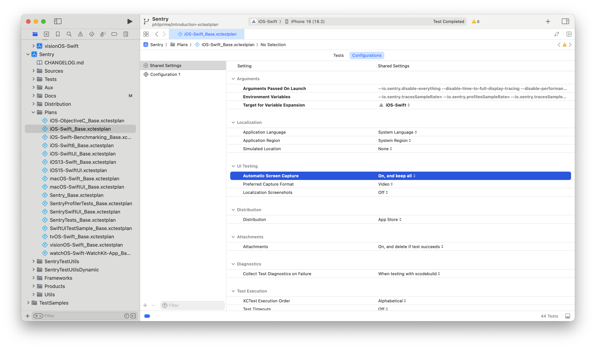
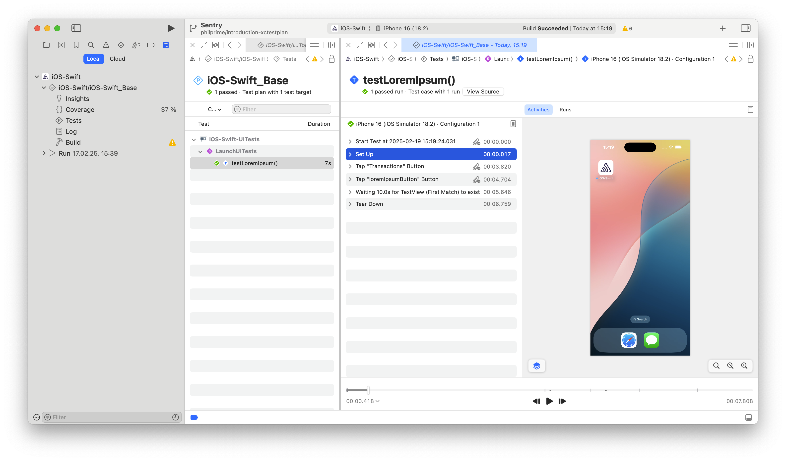

# Testing

## Test Apps

See //TestApps/README.md for more information about how to use these apps to test SDK functionality.

## Tests

The tests depend on our test server. To run the automated tests, you first need to have the server running locally with

```sh
make -C test-server start-debug
```

Test guidelines:

- We default to writing tests in Swift. When touching a test file written in Objective-C consider converting it to Swift and then add your tests.
- Make use of the fixture pattern for test setup code. For examples, checkout [SentryClientTest](/Tests/SentryTests/SentryClientTest.swift) or [SentryHttpTransportTests](/Tests/SentryTests/SentryHttpTransportTests.swift).
- Use [TestData](/Tests/SentryTests/Protocol/TestData.swift) when possible to avoid setting up data classes with test values.
- Name the variable of the class you are testing `sut`, which stands for [system under test](https://en.wikipedia.org/wiki/System_under_test).
- When calling `SentrySDK.start` in a test, specify only the minimum integrations required to minimize side effects for tests and reduce flakiness.

SDK unit tests use the shared `SentrySPM` package scheme, or the platform Make targets:

```sh
make test
```

### Main Test Source Layout

In `Tests/SentryTests`, keep Swift tests in the existing feature directories, Objective-C tests and their headers under `ObjC/`, and Objective-C++ tests under `ObjCpp/`. Preserve the feature hierarchy within each directory.

SDK headers that do not need wrapping are exposed through [`SentryTestUtilsObjC-SDKHeaders.h`](../SentryTestUtils/SourcesObjC/include/SentryTestUtilsObjC-SDKHeaders.h) and the `SentryTestUtilsObjC` package module. Import declarations already exposed by the SDK from their owning modules instead of duplicating them here. `SentryTestUtils` re-exports the helper module and does not use a bridging header.

### Shared Test Support Layout

`SentryTestUtils` keeps the language boundaries required by SwiftPM (`Sources`, `SourcesObjC`, and `SourcesObjCpp`). New files follow this layout within each language directory; existing files retain their current paths:

- **`Wrappers/`** adapts existing SDK functionality to the test module/language boundary. Each SDK adapter file mirrors the SDK header it wraps: for example, `SentryClient+Private.h` maps to `SentryClient+PrivateWrapper.h`. Keep input-only selectors callable directly from their Objective-C declarations. Add matching Swift adapters only when typed results, enum conversion, or overload resolution require them, and Objective-C implementations only when declarations alone are insufficient. Do not combine unrelated SDK types in an SDK-wide access, bridge, or profiling wrapper.
- **The directory root** contains mocks, spies, fixtures, equality categories, cleanup, and general helpers. A mock stays here even when it subclasses a language adapter in `Wrappers/`.

New Objective-C and Objective-C++ headers belong under `include/Wrappers/` for adapters or directly under `include/` for other test helpers; existing exported headers retain their paths. Implementations and implementation-only headers stay outside `include/`; do not add generated Swift interfaces to the shared Clang modules.

[`SentryTestUtilsObjC.h`](../SentryTestUtils/SourcesObjC/include/SentryTestUtilsObjC.h) is the import-only module entry point. The Objective-C++ module keeps C++ declarations textual so non-module consumers can include them too.

Same-named forwarding headers exist only where an original SDK header needs to resolve an internal include by filename. Implementation-only forwarders remain in `SourcesObjC/`; `include/SentryCrashMonitorContext.h` must remain at the exported include root for Swift consumers of `SentryCrashReport.h`. These forwarders are header-search plumbing, not additional wrapper APIs.

### SwiftPM SDK Tests

Open the repository's `Package.swift` in Xcode, select the `SentrySPM` scheme and an available simulator, then press CMD+U. Use the `SentrySPM_Base` test plan for V9. The scheme's Test action uses Debug, which enables testability and exposes the SDK's test hooks through `DEBUG`. Breakpoints and test diamonds operate on the original checkout.

Use `SentrySPM`, not the aggregate `Sentry-Package` scheme. The aggregate scheme includes mutually exclusive binary distributions that produce overlapping framework outputs. Test JSON fixtures live under `Tests/Fixtures` so the package resource bundle does not contain a top-level `Resources` directory that codesign rejects.

The Make/CI test targets continue to pass Test/TestCI and the test xcconfig explicitly for project-equivalent compilation. Those named configurations use `SENTRY_TEST` or `SENTRY_TEST_CI`, while local Debug builds use `DEBUG`. For explicit trait-based macOS tests with Xcode 26 or newer, run from the repository root:

```sh
swift test --traits _SentryTest
swift test --traits _SentryTestCI
# V10: the environment selects the SDK; the test trait enables test helpers.
SDK_V10=1 swift test --traits _SentryTest
```

The `V10` trait has been removed; use `SDK_V10=1` for all V10 package builds. See [SwiftPM V10 selection](BUILD.md#swiftpm-v10-selection).

The test traits match [SDK.xcconfig](../Sources/Configuration/SDK.xcconfig), including Swift's Clang importer:

| Trait           | Swift definitions | Objective-C/C/C++ definitions            |
| --------------- | ----------------- | ---------------------------------------- |
| `_SentryTest`   | `SENTRY_TEST`     | `DEBUG=1 SENTRY_TEST=1`                  |
| `_SentryTestCI` | `SENTRY_TEST_CI`  | `DEBUG=1 SENTRY_TEST=1 SENTRY_TEST_CI=1` |

`_SentryTestCI` does not enable `_SentryTest`. Neither trait changes prebuilt binaries.

> [!WARNING]
> Debug builds include the SDK's test hooks and debug/test behavior, including in source-based consumer builds. This includes synchronous V9 binary-image cache initialization and suppressing the original macOS `_crashOnException:` abort path. Release builds exclude these branches unless a test trait or test flag is explicitly enabled. Do not enable test traits or flags for production builds. The underscore does not make traits private.

To run a specific suite, append `--filter <test-target>`, for example `--filter SentryObjCCompatTests`.

Use `xcodebuild`, not `swift test`, to include Objective-C/Objective-C++ package tests.

#### Package tests with xcodebuild

For project-equivalent compilation or simulator/device tests, use `xcodebuild` with the shared [SentrySPM scheme](../.swiftpm/xcode/xcshareddata/xcschemes/SentrySPM.xcscheme). Select `SentrySPM_Base` for V9 or `SentrySPM_Base_v10` with `SDK_V10=1`. These plans include the main SDK suite, with profiler tests only in V9. V9 crash tests remain in the main suite and use guarded imports of `SentryCrashV9Swift`. `swift test` does not apply Xcode test plans.

`xcodebuild` cannot select root-package traits from the command line, so explicit test flags are still required. Prepare and test a temporary source-only package to avoid duplicate binary outputs:

```sh
package_dir="$(mktemp -d)"
package_test_config="$PWD/Tests/Configuration/SwiftPM.xcconfig"
rsync -a Package*.swift Sources SentryTestUtils SentryTestUtilsDynamic SentryTestUtilsTests Tests Plans "$package_dir/"
package_schemes=.swiftpm/xcode/xcshareddata/xcschemes
mkdir -p "$package_dir/$package_schemes"
cp "$package_schemes/SentrySPM.xcscheme" "$package_dir/$package_schemes/"
printf 'module SentryHeaders { umbrella "." export * }\n' > "$package_dir/Sources/Sentry/Public/module.modulemap"
for manifest in "$package_dir"/Package*.swift; do
  ./scripts/prepare-package.sh --package-file "$manifest" --remove-binary-targets true
done

test_plan=SentrySPM_Base
if [[ "${SDK_V10:-0}" == "1" ]]; then
  test_plan=SentrySPM_Base_v10
fi

status=0
xcodebuild test -workspace "$package_dir" -scheme SentrySPM \
  -configuration Test -parallel-testing-enabled NO \
  -testPlan "$test_plan" \
  -destination 'platform=macOS' \
  -xcconfig "$package_test_config" \
  'SWIFT_ACTIVE_COMPILATION_CONDITIONS=$(inherited) SENTRY_TEST' \
  'GCC_PREPROCESSOR_DEFINITIONS=$(inherited) DEBUG=1 SENTRY_TEST=1' \
  CODE_SIGNING_ALLOWED=NO \
  > "$package_dir/package-tests.log" 2>&1 || status=$?
grep -E 'Executed|error:|TEST SUCCEEDED|TEST FAILED' "$package_dir/package-tests.log"
(test "$status" -eq 0)
```

- For V10, run `export SDK_V10=1` before the commands above.
- Use an available iOS simulator destination for iOS-specific tests. `CODE_SIGNING_ALLOWED=NO` avoids fixture-bundle signing errors on macOS and simulators; device tests need a separate signing configuration.
- Limit a run with `-only-testing:<test-target>`, for example `-only-testing:SentryObjCCompatTests`. Make accepts target, class, and method selectors in `ONLY_TESTING`, including comma-separated combinations. For example, `make test-macos ONLY_TESTING=SentryObjCTests` runs the public Objective-C wrapper suite. The wrapper suites are `SentryObjCTests`, `SentryObjCTestsSwift`, and `SentryObjCCompatTests`.
- Local and CI unit tests share the Make targets: `make test-macos`, `make test-ios`, and the corresponding `-v10` targets use the `SentrySPM` package workspace. Make copies sources, test plans, schemes, and manifests into `TEST_WORKSPACE` (default: `.build/package-tests`) and strips binary targets from the copied manifests. Prepared SDK Base plans omit `SentryDistributionTests`. The dedicated iOS distribution job opts in with `TEST_INCLUDE_DISTRIBUTION=true`, preserving its existing coverage. Checked-in manifests and plans remain unchanged. Use package test identifiers for `ONLY_TESTING`, without a `V10` suffix.
- CI invokes the explicit platform targets with `TEST_CONFIGURATION=TestCI`. The shared unit-test workflow derives the Make target from its `platform` input. Simulator targets use their platform-specific variables, such as `IOS_SIMULATOR_OS` and `IOS_DEVICE_NAME`. These targets select the SDK generation and Base plan, pass the existing package test xcconfig and explicit test definitions, and disable signing. `TEST_PLAN` selects a package Flaky or TestServer plan. `TEST_RESULT_BUNDLE` and `TEST_DERIVED_DATA` override the result bundle name and DerivedData path. Defaults for DerivedData and result bundles are under `RUNNER_TEMP` in CI and the temporary directory locally.
- Set `TEST_COMMAND=build-for-testing` to prepare the package and compile tests. The corresponding `TEST_COMMAND=test-without-building` invocation reuses that package without preparation. Both phases must use the same `TEST_WORKSPACE`, configuration, platform, and destination. Regular, fast-PR, nightly, V10, and distribution jobs use these Make entry points.
- Base-plan exclusions use the owning Swift, Objective-C, or Objective-C++ package test target.
- Use `SentrySPM_Flaky` for V9 flaky tests.
- Use `SentrySPM_TestServer` or `SentrySPM_TestServer_v10` for network tests. Start the server with `make -C test-server start-debug` before that run and stop it with `make -C test-server stop` afterward, including on failure. Do not run unrelated plans while the server is active.

#### Compiler settings and project parity

Plain `swift test` uses SwiftPM's debug and ABI defaults. The opt-in [SwiftPM test configuration](../Tests/Configuration/SwiftPM.xcconfig) aligns package-workspace tests with the project:

- **Test compilation:** `Test`/`TestCI` omit automatic Swift `DEBUG`, preserve manifest definitions, and use unoptimized, testable Sentry builds. Do not substitute `Debug`.
- **Target settings:** `SentryObjCCompat` and `SentryObjCCompatTests` use whole-module compilation. The SDK Swift target (`Sentry` with `SDK_V10=1`, otherwise `SentrySwift`) and `SentryObjCCompat` use library evolution and verify their textual interfaces.
- **Diagnostics:** Sentry-owned targets use warnings-as-errors; dependencies retain their own settings. Avoid global `-Xswiftc -warnings-as-errors` or `-Xcc -Werror` overrides.

Wrapper language features live in the manifests: `MemberImportVisibility` and approachable concurrency are enabled unconditionally, as both are available in the oldest supported Xcode (26, Swift 6.2). They apply to ordinary builds and tests, while the xcconfig remains test-only. See its comments for setting-specific rationale.

The package still checks warnings in legacy `SentryCrashSysCtl.c`, unlike the project. When changing settings, compare actual compiler commands, interface-verification results, and V9/V10 test identifiers and pass/skip outcomes. Confirm dependency diagnostics and ordinary consumer builds remain unchanged.

### Thread Inspection Sanitizers

The [thread-inspection harness](../Tests/ThreadInspectionHarness/) runs with AddressSanitizer, UndefinedBehaviorSanitizer, and ThreadSanitizer in [Test V10](../.github/workflows/test-v10.yml). This coverage is independent of the SDK package test plans.

### Using Xcode Test Plans

Test plans in Xcode provide a convenient way to organize and configure test execution.
They allow us to segment tests into different groups and configure specific test environments without creating additional targets or schemes.
Furthermore, test plans provide additional features such as built-in test repetition and retry on failures, automatic screen capture for debugging UI test failures, and custom test configurations for different scenarios.

Each Xcode scheme can have multiple test plans configured, but only one test plan can be marked as the default test plan.
When adding new test plans, they must also be added to the relevant schemes.

Some of the features of test plans are:

- Built-in test repetition and retry on failures
- Automatic screen capture for debugging UI test failures
- Custom test configurations for different scenarios

Additional outputs are written to the Xcode results (`.xcresult`) files, which can be found in the `~/Library/Developer/Xcode/DerivedData/.../Logs/Test/` directory.

#### Base Test Plans

We maintain "base" test plans that automatically include all new tests as they are configured by defining a list skipped tests.
This prevents tests from being accidentally excluded and provides convenience when adding new test files.

In case a test is manually marked as skipped in the test plan, it should be added to another test plan (which must also be used in the CI workflow).
When using `xcodebuild` to run tests, only the default test plan is executed unless explicitly specified with the -testPlan argument.

#### Test Plan Organization

Test plans are stored in the repository root since they are shared between test apps and SDK targets.
This central location makes them easily accessible while maintaining the relationship between plans and schemes.

#### UI Test Recording

It is possible to record UI tests by changing the test plan configuration `Automatic Screen Capture` to `On, and keep all` or `On, and delete if test succeeds`.

After running the tests with the configuration set, it is possible to open the test results in Xcode, inspect the tests in detail by double clicking them.



The details of the test case will display the UI Test history and also display playback of the screen captures.



#### Further Resources

For more details on test plans and their capabilities, refer to:

- [WWDC21 video on Test Plans](https://developer.apple.com/videos/play/wwdc2021/10296/)
- [Apple's documentation on Test Plans](https://developer.apple.com/documentation/xcode/running-tests-and-interpreting-results)

### Test Logs

We used to set the log level to debug all tests to investigate flaky tests. For individual tests we then disabled the logs because printing the messages via NSLog uses synchronization and caused specific tests to fail due to timeouts in CI. The debug logs can also be extremely verbose for tests using tight loops and completely spamming the test logs.

Therefore, the default log level is error for tests. If debug logs can help with fixing flaky tests, we should enable these for specific test cases only with `SentrySDKLog.withDebugLogs`.

### UI Tests

CI runs UI tests on simulators via the `ui-tests.yml` workflow for every PR and every commit on main.

#### Saucelabs

You can find the available devices on [their website](https://saucelabs.com/platform/supported-browsers-devices). Another way to check their available devices is to go to [live app testing](https://app.saucelabs.com/live/app-testing), go to iOS-Swift and click on choose device. This brings the full list of devices with more details.

### Test Expectations

We recommend using `XCTAssertEqual(<VALUE>, <EXPECTED VALUE>)` over `XCTAssertEqual(<EXPECTED VALUE>, <VALUE>)` for no strong reason, but to align so tests are consistent and therefore easier to read.

### Teardown

Ideally, tests shouldn't need teardown at all — prefer designing tests so they don't leave behind shared state. When teardown is necessary (e.g., resetting globals), prefer [`addTeardownBlock`](https://developer.apple.com/documentation/xctest/xctestcase/addteardownblock(_:)-5gief) over a global [`tearDown()`](https://developer.apple.com/documentation/xctest/xctestcase/teardown()-8jkux) method. `addTeardownBlock` lets you scope cleanup to the specific test that introduced the state, keeping unrelated tests free of unnecessary teardown logic. This makes tests easier to understand and maintain, because the setup and cleanup live together in one place.

For example, if only two tests in a class set a global measurement, only those two tests should clean it up:

```swift
func testColdStart_shouldSetMeasurement() {
    SentrySDK.setAppStartMeasurement(coldStartMeasurement)
    addTeardownBlock { SentrySDK.setAppStartMeasurement(nil) }
    // ...
}
```

### Binary Image Unload Regression Test

`SentryKSCrashBinaryImageProviderTests` covers an image that really unloads while the provider reads it. The pure-C `SentryUnloadingImage.framework` fixture is embedded without linking it at launch. The test is the sole owner of the only `dlopen` reference and closes it between image-address acquisition and metadata extraction, then asserts that the header became unreadable. This fixture must stay free of Swift or Objective-C metadata and _must not_ link it into the test bundle because either could keep the image mapped, and the regression would no longer unload anything.

The regression runs in Make-driven package tests on macOS and simulators. V10 Make targets enable `SENTRY_PACKAGE_TEST_FIXTURES`. After the package build, `scripts/build-package-test-fixture.sh` compiles and embeds the fixture in the main test bundle without linking it. Split build and execution phases reuse the embedded fixture. Use the Make targets for this regression, since a bare `swift test` or `xcodebuild` invocation does not embed it.

The package tests are tool-hosted, so `xcodebuild test` fails on physical devices with

```
Tool-hosted testing is unavailable on device destinations
```

Signing alone doesn't fix this. To run on a device, one must build with `build-for-testing` and run the test bundle in a separate app that hosts it, with the host app, test bundle, and embedded frameworks all dev-signed.

The repository doesn't currently include such a host app and adding one is not strictly necessary for regression testing, since the simulator behavior is equivalent in that regard.

## Performance benchmarking

Once daily and for every PR via [Github action](../.github/workflows/benchmarking.yml), the benchmark runs in Sauce Labs, on a [high-end device](https://github.com/getsentry/sentry/blob/8986f81e19f63ee370b1649e08630c9b946c87ed/src/sentry/profiles/device.py#L43-L49) we categorize. Benchmarks run from an XCUITest (`iOS-Benchmarking` target) using the iOS-Swift test app, under the `iOS-Benchmarking` scheme. [`PerformanceViewController`](../TestApps/iOS-Swift/ViewControllers/PerformanceViewController.swift) provides a start and stop button for controlling when the benchmarking runs, and a text field to marshal observations from within the test harness app into the test runner app. There, we assert that the P90 of all trials remains under 5%. We also print the raw results to the test runner's console logs for postprocessing into reports with `//scripts/process-benchmark-raw-results.py`.

### Test procedure

- Tap the button to start a Sentry transaction with the associated profiling.
- Run a loop performing large amount of calculations to use as much CPU as possible. This simulates something an app developer would want to profile in a real world scenario.
- While benchmarking, run a sampling profiler at 10 Hz to calculate the CPU usage of each thread, in particular the Sentry profiler's, to calculate its relative usage.
- Tap the button to stop the transaction after waiting for 15 seconds.
- Calculate the total time used by app threads and separately, the profiler's thread. Keep separated by system call and user call times.
- Write these four values as CSV into the text field accessible as an XCUIElement in the runner app.

### Test Plan

- Run the procedure 20 times, then assert that the 90th percentile remains under 5% so we can be alerted via CI if it spikes.
  - Sauce Labs allows relaxing the timeout for a suite of tests and for a `XCTestCase` subclass' collection of test case methods, but each test case in the suite must run in less than 15 minutes. 20 trials takes too long, so we split it up into multiple test cases, each running a subset of the trials.
  - This is done by dynamically generating test case methods in `SentrySDKPerformanceBenchmarkTests`, which is necessarily written in Objective-C since this is not possible to do in Swift tests. By doing this dynamically, we can easily fine tune how we split up the work to account for changes in the test duration or in constraints on how things run in Sauce Labs etc.

### Flaky tests

If you see a test being flaky, you should ideally fix it immediately. If that's not feasible, you can add it to the SentrySPM_Flaky test plan and remove it from the SentrySPM_Base test plan. The SentrySPM_Flaky test plan has a retry mechanism of 3 times until a test officially fails.

Or you disable the test in the test scheme by unchecking it in the associated test plan:


Then create a GH issue with the [flaky test issue template](https://github.com/getsentry/sentry-cocoa/issues/new?assignees=&labels=Platform%3A+Cocoa%2CType%3A+Flaky+Test&template=flaky-test.yml).

Disabling the test in the test plan has the advantage that the test report will state "X tests passed, Y tests failed, Z tests skipped", as well as maintaining a centralized list of skipped tests (look in the associated .xctestplan file source in //Plans/) and they will be grayed out when viewing in the Xcode Tests Navigator (⌘6):


